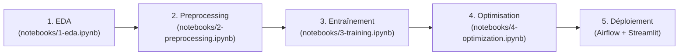
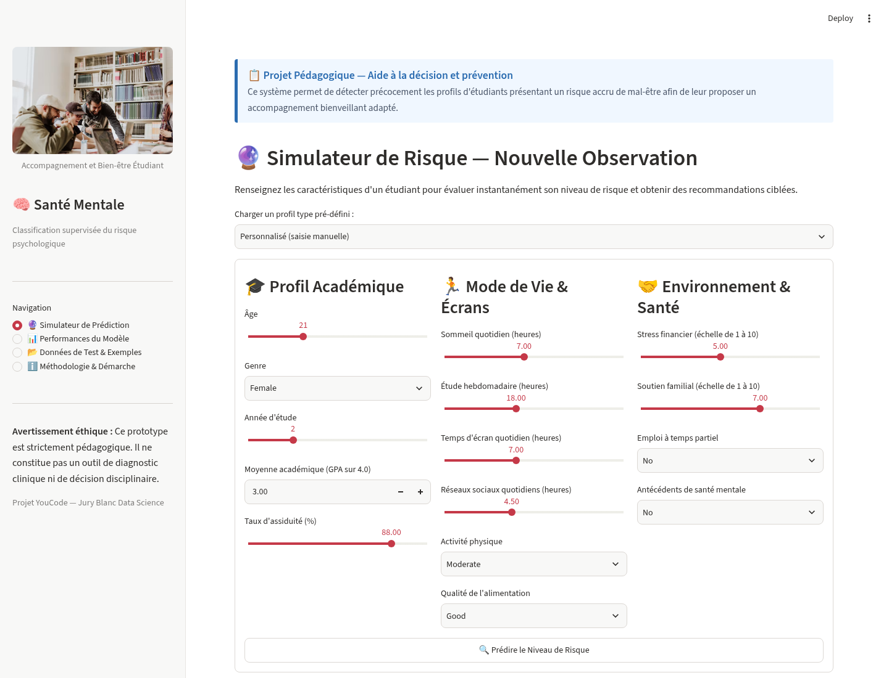
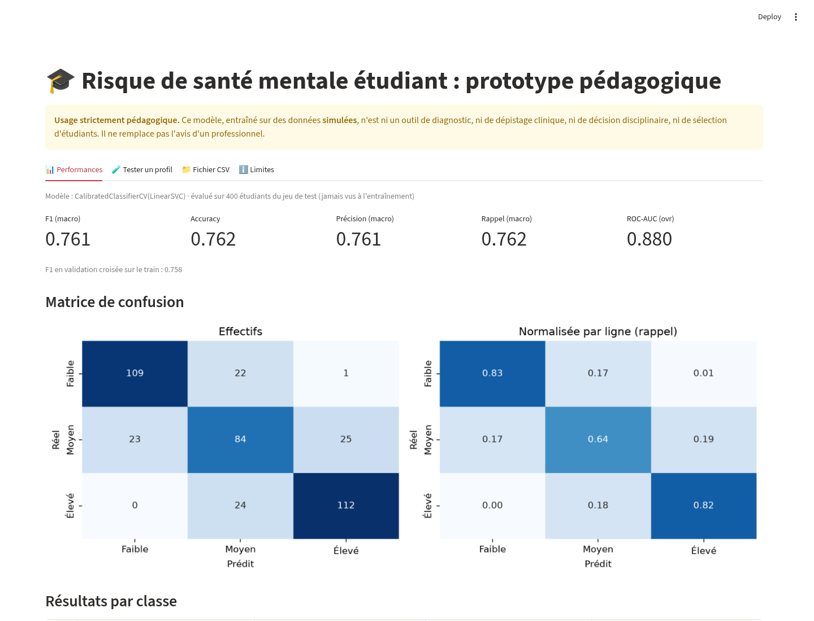
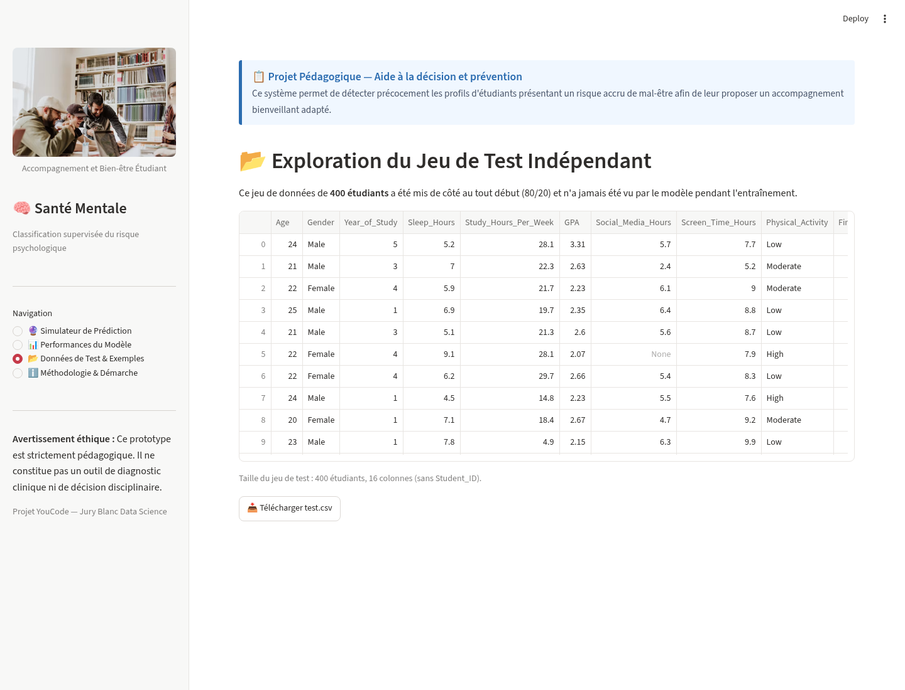

# 🧠 Prédiction du Risque de Santé Mentale chez les Étudiants

[](https://www.python.org/)
[](https://streamlit.io/)
[](https://airflow.apache.org/)
[](https://scikit-learn.org/)
[](https://www.docker.com/)
[](https://bahaztariq.atlassian.net/jira/software/projects/MTL/boards/102?filter=&groupBy=none&atlOrigin=eyJpIjoiZTRjY2M0M2VmYjk3NDBlY2JjMGZlZTNmODMwNmNiZGYiLCJwIjoiaiJ9)

---

> 🔗 **Suivi de Projet & Gestion Agile** :  
> Le suivi des tâches et des sprints est accessible sur le board Jira officiel du projet :  
> 👉 [**Accéder au tableau de bord Jira (Projet MTL)**](https://bahaztariq.atlassian.net/jira/software/projects/MTL/boards/102?filter=&groupBy=none&atlOrigin=eyJpIjoiZTRjY2M0M2VmYjk3NDBlY2JjMGZlZTNmODMwNmNiZGYiLCJwIjoiaiJ9)

---

## 📌 1. Contexte du Projet & Objectifs Métier

Projet Data Science réalisé dans le cadre du **Brief Jury Blanc (YouCode)**.  
L'objectif est d'étudier les facteurs associés aux difficultés psychologiques chez les étudiants, de concevoir un pipeline rigoureux de Machine Learning supervisé (classification multi-classes : `Low`, `Medium`, `High`), et de déployer une solution complète comprenant une orchestration automatisée avec **Apache Airflow** et une interface d'aide à la décision interactive avec **Streamlit**.

### 🎯 Objectifs Métier
* **Détection précoce des risques :** Identifier les étudiants présentant un risque accru de détresse psychologique.
* **Prévention ciblée :** Anticiper les besoins d'accompagnement avant l'aggravation des symptômes ou le décrochage académique.
* **Compréhension des facteurs déterminants :** Mettre en évidence les leviers d'action (sommeil, stress financier, soutien familial, équilibre vie-études).
* **Orientation & Accompagnement :** Faciliter la mise en relation bienveillante avec les cellules d'écoute et les services sociaux universitaires.
* **Priorisation des ressources :** Optimiser l'allocation des effectifs d'aide médico-sociale sur le campus.

> ⚠️ **Avertissement éthique et légal (Strictement Pédagogique) :**  
> Ce système constitue un prototype d'aide à l'orientation et à la prévention précoce basé sur des données synthétiques.  
> **Il ne doit en aucun cas être utilisé comme un outil de diagnostic médical, de dépistage clinique, de sélection d'étudiants, d'évaluation académique ou de décision disciplinaire.**

---

## 📊 2. Jeu de Données (Dataset)

* **Source :** [Mental Health Risk Prediction Dataset — Students (Kaggle)](https://www.kaggle.com/datasets/maqdadali/mental-health-risk-prediction-dataset-students)
* **Emplacement local :** `data/raw/student_mental_health.csv`
* **Dimensions :** 2 000 observations, 17 variables (16 caractéristiques explicatives + 1 cible)
* **Partitionnement :** Split strict 80 % entraînement (1 600 lignes) / 20 % test indépendant (400 lignes), stratifié sur la cible.

### Dictionnaire des variables

| Variable | Type | Description | Traitement dans le Pipeline |
|---|---|---|---|
| `Student_ID` | Identifiant | Identifiant unique de l'étudiant | Supprimé (aucune valeur prédictive) |
| `Age` | Numérique | Âge de l'étudiant (18–35 ans) | Médiane + Standardisation |
| `Gender` | Catégoriel | Genre (`Male`, `Female`, `Other`) | One-Hot Encoding |
| `Year_of_Study` | Numérique | Année du cursus universitaire (1 à 5) | Médiane + Standardisation |
| `Sleep_Hours` | Numérique | Heures de sommeil moyen par nuit (h) | Médiane + Capping IQR + Standardisation |
| `Study_Hours_Per_Week` | Numérique | Heures d'étude par semaine (h) | Médiane + Capping IQR + Standardisation |
| `GPA` | Numérique | Moyenne académique (échelle 0.0 à 4.0) | Médiane + Capping IQR + Standardisation |
| `Social_Media_Hours` | Numérique | Temps quotidien sur les réseaux sociaux (h) | Médiane + Capping IQR + Standardisation |
| `Screen_Time_Hours` | Numérique | Temps d'écran quotidien total (h) | Médiane + Capping IQR + Standardisation |
| `Physical_Activity` | Catégoriel Ordinal | Activité physique (`Low`, `Moderate`, `High`) | Encodage Ordinal [0, 1, 2] |
| `Financial_Stress` | Numérique | Niveau de stress financier (score 1 à 10) | Médiane + Standardisation |
| `Family_Support` | Numérique | Niveau de soutien familial perçu (score 1 à 10) | Médiane + Standardisation |
| `Attendance_Rate` | Numérique | Taux d'assiduité aux cours (%) | Médiane + Capping IQR + Standardisation |
| `Part_Time_Job` | Binaire | Exercice d'un emploi étudiant (`Yes`, `No`) | One-Hot Encoding |
| `Diet_Quality` | Catégoriel Ordinal | Qualité perçue du régime alimentaire (`Poor`, `Average`, `Good`) | Encodage Ordinal [0, 1, 2] |
| `Previous_Mental_Health_History` | Binaire | Antécédents de santé mentale personnels (`Yes`, `No`) | One-Hot Encoding |
| **`Mental_Health_Risk`** | **Cible (3 classes)** | **Niveau de risque global (`Low`, `Medium`, `High`)** | Variable cible à prédire |

---

## 🧭 3. Démarche Méthodologique

Le projet suit rigoureusement les 5 étapes demandées par le brief pédagogique :



### Étape 1 — Chargement & Analyse Exploratoire (EDA)
* Audit de conformité : structure des types, absence de doublons d'enregistrement, analyse des valeurs manquantes (~0.5 % sur quelques colonnes).
* Analyse de distribution : répartition équilibrée de la cible multi-classes (~33 % pour chaque classe `Low`, `Medium`, `High`).
* Détection statistique des valeurs aberrantes (*outliers*) via la méthode de l'écart interquartile (IQR).
* Analyse de corrélation et d'association (Pearson, Spearman et ANOVA) : mise en évidence d'une relation monotone forte entre le déficit de sommeil, le stress financier élevé, le manque de soutien familial et l'élévation du risque psychologique.

### Étape 2 — Transformation & Préparation des Données
* **Split étanche :** Séparation immédiate train (80 %) / test (20 %) avec stratification afin de garantir l'absence absolue de fuite d'information (*data leakage*).
* **Imputation robuste :** `SimpleImputer` par la médiane pour les variables continues et par le mode (`most_frequent`) pour les variables catégorielles.
* **Traitement des outliers :** Création d'un transformateur scikit-learn sur mesure (`IQRCapper`) calculant les bornes $[Q_1 - 1.5 \times IQR, Q_3 + 1.5 \times IQR]$ uniquement sur le jeu d'entraînement.
* **Encodage différentié :**
  * `OneHotEncoder(handle_unknown='ignore')` pour les variables nominales (`Gender`, `Part_Time_Job`, `Previous_Mental_Health_History`).
  * `OrdinalEncoder` respectant la sémantique ordonnée (`Physical_Activity`, `Diet_Quality`).
* **Standardisation :** `StandardScaler` pour aligner les échelles numériques sans biaiser les estimateurs à base de marge ou de gradient.
* **Sérialisation :** Pipeline de prétraitement complet sauvegardé dans `data/processed/preprocessor.pkl`.

### Étape 3 — Entraînement & Comparaison des Modèles
Comparaison sur le même ensemble d'entraînement via validation croisée stratifiée à 5 plis (*Stratified 5-Fold CV*) :
1. **Régression Logistique Multinomiale (Baseline)** : Modèle linéaire régularisé $L_2$.
2. **Support Vector Machine (Linear SVM)** : Séparateur à marge maximale avec noyau linéaire.
3. **Random Forest Classifier** : Ensemble d'arbres décisionnels avec bagging.

### Étape 4 — Optimisation & Évaluation Finale
* **Fine-tuning des hyperparamètres :** Recherche exhaustive sur grille (`GridSearchCV`) sur le paramètre de régularisation $C$ et la perte `hinge`/`squared_hinge`.
* **Calibration de probabilités :** Utilisation de `CalibratedClassifierCV(method='sigmoid')` afin de fournir à l'interface applicative des probabilités prédites fiables pour les 3 classes.
* **Évaluation sur test indépendant (400 étudiants) :** Calcul de l'Accuracy, du Rappel, de la Précision et du F1-score pondéré ainsi que du score ROC-AUC multiclasse (One-vs-Rest).
* **Export de production :** Pipeline complet de bout en bout sérialisé dans `models/mental_health_risk_pipeline.pkl`.

### Étape 5 — Orchestration Airflow & Application Streamlit
* **DAG Apache Airflow (`dags/mental_health_dag.py`) :** Pipeline automatisé composé de 4 tâches séquentielles :
  1. `check_raw_data` : validation de présence du fichier de données brutes.
  2. `preprocess_data` : exécution du pipeline de nettoyage et split train/test.
  3. `train_model` : entraînement du SVM calibré.
  4. `evaluate_model` : vérification des seuils de performance avant mise en production.
* **Application interactive Streamlit (`app/streamlit_app.py`) :** Interface ergonomique comprenant un simulateur de prédiction en temps réel, un tableau de bord analytique des métriques, une exploration interactive du jeu de test et un rappel méthodologique complet.

---

## 📈 4. Résultats et Métriques de Performance

### Comparatif sur le Jeu de Test Indépendant (400 étudiants)

| Modèle | F1-Score (pondéré) | Accuracy | ROC-AUC (ovr) | Précision (pondérée) | Rappel (pondéré) | Décision |
| :--- | :---: | :---: | :---: | :---: | :---: | :---: |
| 🏆 **Linear SVM (Optimisé + Calibré)** | **76.21 %** | **76.25 %** | **88.08 %** | **76.17 %** | **76.25 %** | **Retenu pour la Production** |
| Logistic Regression (Baseline) | 75.75 % | 75.75 % | 91.50 % | 76.10 % | 75.75 % | Modèle de référence |
| SVM (Baseline brute non optimisée) | 72.14 % | 72.25 % | — | 72.10 % | 72.25 % | Améliorable par tuning |
| Random Forest Classifier | 67.21 % | 67.75 % | 85.28 % | 67.89 % | 67.75 % | Écarté (surapprentissage des frontières) |

### Matrice de Confusion du Modèle Final (400 étudiants)

```text
                     Prédit Low      Prédit Medium      Prédit High
  Réel Low              109               22                 1
  Réel Medium            23               84                25
  Réel High               0               24               112
```

### 🔍 Analyse Qualifiée des Résultats
* **Absence de faux négatifs critiques :** **0 étudiant** à risque élevé (`High`) n'a été classé à tort en risque faible (`Low`). Cette propriété est primordiale sur le plan éthique et préventif.
* **Erreurs adjacentes tolérables :** La quasi-totalité des confusions résiduelles survient entre classes immédiatement contiguës (`Low` $\leftrightarrow$ `Medium` et `Medium` $\leftrightarrow$ `High`).
* **Interprétabilité clinique :** Les variables ayant les poids normalisés les plus déterminants sont la privation de sommeil, le stress financier et l'absence de soutien familial.

---

## 🏗️ 5. Structure du Répertoire

Le projet est rigoureusement structuré conformément aux exigences du brief :

```
mental/
├── app/
│   └── streamlit_app.py              # Application interactive Streamlit
├── assets/
│   └── screenshots/                  # Captures d'écran de l'application
│       ├── streamlit_simulator.png
│       ├── streamlit_performances.png
│       └── streamlit_test_data.png
├── dags/
│   └── mental_health_dag.py          # DAG d'orchestration Apache Airflow
├── data/
│   ├── processed/                    # Données préparées et sérialisées
│   │   ├── preprocessor.pkl          # Pipeline de prétraitement fitté
│   │   ├── train.csv                 # 80 % jeu d'entraînement (1 600 lignes)
│   │   └── test.csv                  # 20 % jeu de test indépendant (400 lignes)
│   └── raw/
│       └── student_mental_health.csv # Jeu de données brut Kaggle
├── models/
│   ├── final_evaluation.pkl          # Métriques et matrices d'évaluation
│   ├── logistic_regression_baseline.pkl
│   ├── mental_health_risk_pipeline.pkl # Pipeline complet fitté de bout en bout
│   └── metrics.json                  # Métriques JSON pour l'application Streamlit
├── notebooks/
│   ├── 1-eda.ipynb                   # Étape 1 : Analyse exploratoire
│   ├── 2-preprocessing.ipynb         # Étape 2 : Préparation et transformation
│   ├── 3-training.ipynb              # Étape 3 : Entraînement et comparaison
│   └── 4-optimization.ipynb          # Étape 4 : Optimisation et évaluation
├── src/
│   ├── __init__.py
│   ├── config.py                     # Constantes et chemins du projet
│   ├── inference.py                  # Fonctions de validation et prédiction Streamlit
│   └── preprocessing_utils.py        # Module utilitaire (classe IQRCapper)
├── .dockerignore                     # Optimisation du contexte de build Docker
├── BRIEF SC1.md                      # Cahier des charges officiel du Jury Blanc
├── Dockerfile                        # Image conteneur de production Streamlit
├── docker-compose.yml                # Orchestration multi-services (Streamlit + Airflow)
├── README.md                         # Documentation complète du projet
└── requirements.txt                  # Dépendances Python pip
```

---

## ⚙️ 6. Guide d'Installation

### Prérequis
* **Python** : 3.10, 3.11 ou 3.12
* **Git**
* *(Optionnel pour le déploiement conteneurisé)* : **Docker** & **Docker Compose**

### Installation Locale en Environnement Virtuel Standard (`venv`)

```bash
# 1. Cloner le dépôt Git
git clone https://github.com/bahaztariq/mental.git
cd mental

# 2. Créer l'environnement virtuel Python standard
python3 -m venv .venv

# 3. Activer l'environnement virtuel
# Sur Linux / macOS :
source .venv/bin/activate
# Sur Windows :
# .venv\Scripts\activate

# 4. Mettre à jour pip et installer toutes les dépendances
pip install --upgrade pip
pip install -r requirements.txt
```

---

## ▶️ 7. Guide d'Exécution

### 1. Exploration des Notebooks Jupyter

Pour relancer l'ensemble de la démarche pas à pas :

```bash
source .venv/bin/activate
jupyter lab
```
Naviguez ensuite dans le répertoire `notebooks/` et exécutez les notebooks dans l'ordre :
`1-eda.ipynb` $\rightarrow$ `2-preprocessing.ipynb` $\rightarrow$ `3-training.ipynb` $\rightarrow$ `4-optimization.ipynb`.

### 2. Lancer l'Application Streamlit en Local

```bash
source .venv/bin/activate
export PYTHONPATH=$PWD/src
streamlit run app/streamlit_app.py
```
L'interface s'ouvre automatiquement à l'adresse : **[http://localhost:8501](http://localhost:8501)**.

### 3. Lancer l'Environnement Complet avec Docker Compose

Pour déployer simultanément l'application web Streamlit et le serveur d'orchestration Apache Airflow dans des conteneurs isolés :

```bash
docker compose up --build -d
```

| Service | URL d'accès | Identifiants par défaut | Rôle |
|---|---|---|---|
| **Streamlit Web App** | [http://localhost:8501](http://localhost:8501) | *Accès direct sans mot de passe* | Interface interactive de simulation et d'analyse |
| **Apache Airflow UI** | [http://localhost:8080](http://localhost:8080) | `admin` / `admin` | Supervision et déclenchement des pipelines MLOps |

Pour arrêter les services :
```bash
docker compose down
```

---

## 📸 8. Galerie de l'Application Streamlit

### Simulateur de Prédiction en Temps Réel
Permet de renseigner ou de pré-remplir le profil d'un étudiant pour obtenir une estimation instantanée de son niveau de risque avec les probabilités associées et des conseils d'orientation bienveillants :


### Performances du Modèle & Matrice de Confusion
Affiche les indicateurs de performance (F1-score, Accuracy, ROC-AUC), la matrice de confusion normalisée et le tableau comparatif des modèles entraînés :


### Exploration du Jeu de Test Indépendant
Permet d'explorer les 400 étudiants du jeu de test mis de côté à l'étape 2 et de télécharger le fichier CSV correspondant :


---

## 📅 9. Gestion de Projet & Suivi Jira

Le projet a été piloté suivant les principes agiles Scrum/Kanban avec découpage fonctionnel des user stories et suivi d'avancement sur Jira :

* 🔗 **Lien direct :** [Tableau Jira — Projet MTL](https://bahaztariq.atlassian.net/jira/software/projects/MTL/boards/102?filter=&groupBy=none&atlOrigin=eyJpIjoiZTRjY2M0M2VmYjk3NDBlY2JjMGZlZTNmODMwNmNiZGYiLCJwIjoiaiJ9)
* **Organisation des Épics & Tâches :**
  * `MTL-1` : Analyse exploratoire des données (EDA) et audit de qualité.
  * `MTL-2` : Feature engineering, imputations, capping IQR et pipelines anti-leakage.
  * `MTL-3` : Benchmark de 3 algorithmes de classification et validation croisée.
  * `MTL-4` : Optimisation par GridSearchCV, calibration de probabilités et export du pipeline.
  * `MTL-5` : Développement de l'orchestration avec DAG Airflow.
  * `MTL-6` : Développement de l'interface graphique interactive avec Streamlit.
  * `MTL-7` : Conteneurisation Docker, Docker Compose et finalisation documentaire.

---

## 👤 Auteur & Informations Académiques

* **Auteur :** Bahaz Tariq (`bahaztariq@gmail.com`)
* **Formation :** YouCode — Jury Blanc Data Science
* **Période :** Du 09/11/2026 au 14/11/2026
* **Soutenance :** 16/11/2026 (45 minutes)

---

## 📄 Licence

Ce projet est sous licence MIT dans le cadre des activités pédagogiques de YouCode.
